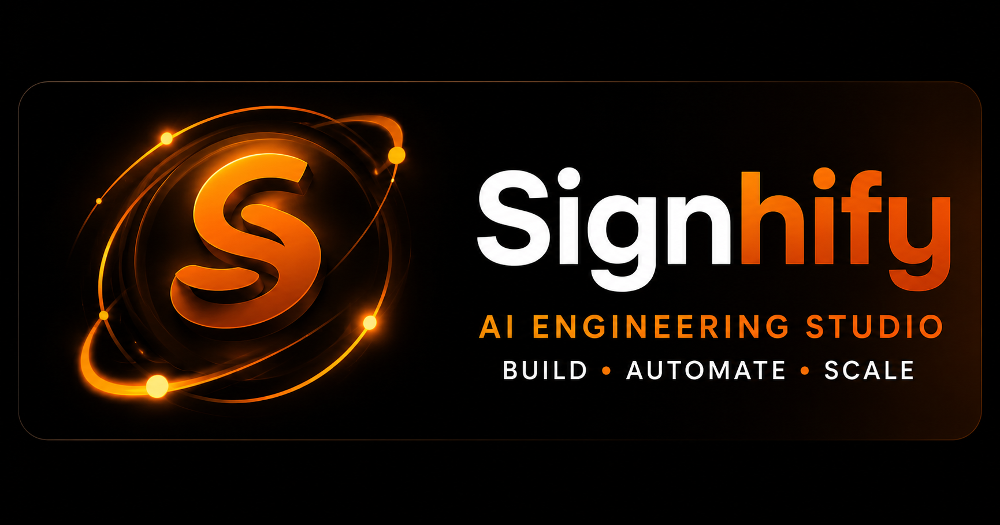

<p align="center">
  <picture>
    <source media="(prefers-color-scheme: dark)" srcset="./assets/banners/signhify-banner-dark.png">
    
  </picture>
  <br>
  <em>Your AI engineering partner — in the terminal and in the IDE</em>
</p>

<p align="center">
  <a href="https://github.com/Warriorlegacy/Signhify_CLI/blob/main/LICENSE">
    
  </a>
  <a href="https://www.npmjs.com/package/@signhify/cli">
    
  </a>
  <a href="https://github.com/Warriorlegacy/Signhify_CLI/releases">
    
  </a>
  <a href="https://github.com/Warriorlegacy/Signhify_CLI/actions/workflows/test.yml">
    
  </a>
  <a href="https://nodejs.org/">
    
  </a>
  <a href="https://github.com/Warriorlegacy/Signhify_CLI/blob/main/CONTRIBUTING.md">
    
  </a>
  <a href="https://github.com/Warriorlegacy/Signhify_CLI/discussions">
    
  </a>
</p>

---

Signhify CLI is an AI-native developer tooling platform that that plans, writes, tests, and fixes code from natural language. It remembers your project across sessions, runs unattended in CI/CD, and ships as both a **CLI** and a **VS Code extension** sharing one core engine.

## Features

- **Multi-agent modes** — Build (full access), Plan (read-only), Debug, Compose
- **Role-based subagents** — dependency-aware pipelines, persisted task states, and bounded parallel discovery; edits and commands still pass through host permissions
- **Run cancellation** — press Esc in the interactive CLI to stop provider streaming and shell work and block queued subagent tasks
- **Multi-provider** — OpenAI, Anthropic, Google Gemini, or any OpenAI-compatible endpoint (Ollama, Groq, OpenRouter, etc.)
- **Two-tier model routing** — fast model for inline autocomplete, reasoning model for agent loop
- **Persistent memory** — SQLite + FTS5 for fast retrieval, human-readable markdown for auditability
- **Project guidance** — scoped `AGENTS.md` / `CLAUDE.md` instructions and discoverable local skills
- **Checkpoint system** — auto-snapshot at 80% context window; resume mid-task without truncation
- **Goal/judge verification** — set a stop condition, verified by independent model
- **Dream/Distill** — session trace distillation into long-term memory and reusable agents
- **MCP support** — Model Context Protocol client for extensibility (servers, tools, resources)
- **CI/CD mode** — `--auto --output json` for scripted pipelines
- **VS Code extension** — chat panel + inline autocomplete

## Quick Install

### Universal Single Command (macOS, Linux, Windows)

```bash
npm install -g @signhify/cli
```

### Zero-Install Run (All OS)

```bash
npx @signhify/cli
```

### Alternative Platform Shell Scripts

- **Windows (PowerShell):** `irm https://signhify-cli.vercel.app/install.ps1 | iex`
- **macOS / Linux (bash):** `curl -fsSL https://signhify-cli.vercel.app/install.sh | bash`

## Multi-Provider BYOK (Bring Your Own Key)

Signhify is built from the ground up on a hardened **Bring Your Own Key (BYOK)** architecture. You maintain 100% ownership of your credentials, model selections, and data boundaries. Switch effortlessly between frontier cloud models, cost-efficient aggregators, and private air-gapped local inference with zero vendor lock-in.

### Supported Providers & Models

| Provider | Supported Models | Primary Capabilities | Key Format / Prefix Guidance |
|---|---|---|---|
| **Anthropic** | Claude 3.5 Sonnet, Claude 3.5 Haiku, Claude 3 Opus | Complex multi-file reasoning, refactoring, agentic code edits | Starts with `sk-ant-` (~100+ chars) |
| **OpenAI** | GPT-4o, o1, o1-mini, GPT-4o-mini | Deep logical planning, code synthesis, rapid debugging | Starts with `sk-` (~50+ chars) |
| **Google Gemini** | Gemini 1.5 Pro, Gemini 2.0 Flash | Ultra-large 2M token context window, repository ingest | Starts with `AIzaSy` (~39 chars) |
| **Groq** | Llama 3.3 70B, Mixtral 8x7B | Ultra-low-latency real-time inference (>200 tok/s) | Starts with `gsk_` (~56 chars) |
| **DeepSeek** | DeepSeek-V3, DeepSeek-R1 | High-capability reasoning and math at fraction of cloud cost | Starts with `sk-` (~32 chars) |
| **OpenRouter** | Claude, Llama 3, Qwen 2.5, DeepSeek, Mistral | Unified gateway across 200+ open and proprietary models | Starts with `sk-or-v1-` or `sk-or-` |
| **Mistral AI** | Mistral Large 2, Codestral | Specialized European AI, code-completion, multilingual coding | Standard 32-char hex string |
| **Ollama** | Llama 3.2, Qwen 2.5 Coder, DeepSeek R1, CodeLlama | 100% offline, private, zero-cost air-gapped inference | Localhost (`http://localhost:11434/v1`) |
| **OpenAI-Compatible** | vLLM, LM Studio, LocalAI, Together AI, Cerebras, Fireworks | Any standard OpenAI-compatible REST server or inference proxy | Base URL + optional Bearer token |

### Setup Methods

Signhify offers four frictionless, battle-tested methods to configure and supply BYOK credentials:

#### 1. Interactive Setup Wizard (`signhify configure`)
Run the interactive setup wizard at any time to configure your active agent model, fast autocomplete model, and credential references:
```bash
# Launch interactive configuration wizard
signhify configure
# or
signhify wizard
```
The wizard verifies provider connectivity, validates key formats, and automatically saves credentials to your operating system's native keychain.

#### 2. Environment Variables
Inject credentials through shell environment variables or CI/CD pipeline secrets. Signhify detects both namespaced and canonical provider variables:
```bash
# Dedicated namespaced variables (highest precedence)
export SIGNHIFY_ANTHROPIC_API_KEY="sk-ant-..."
export SIGNHIFY_OPENAI_API_KEY="sk-..."
export SIGNHIFY_GEMINI_API_KEY="AIzaSy..."
export SIGNHIFY_GROQ_API_KEY="gsk_..."
export SIGNHIFY_DEEPSEEK_API_KEY="sk-..."
export SIGNHIFY_OPENROUTER_API_KEY="sk-or-..."

# Standard vendor variables (automatic fallback)
export ANTHROPIC_API_KEY="sk-ant-..."
export OPENAI_API_KEY="sk-..."
export GOOGLE_GENERATIVE_AI_API_KEY="AIzaSy..."
export GROQ_API_KEY="gsk_..."
export DEEPSEEK_API_KEY="sk-..."
export MISTRAL_API_KEY="..."
```

#### 3. CLI Flags
Pass ephemeral model and credential overrides directly to any command:
```bash
# Start interactive TUI with a specific provider and key
signhify --provider anthropic --api-key sk-ant-...

# Autonomous CI execution using local Ollama (zero network cost)
signhify run "run lint and typecheck" --provider ollama --model qwen2.5-coder:7b --auto

# High-velocity execution using Groq Llama 3.3
signhify run "generate unit test suite" --provider groq --api-key gsk_... --auto
```

#### 4. Project & User Config (`signhify.config.json`)
Configure your project in `.signhify/config.json` or user profile in `~/.config/signhify/config.json`. Credentials can reference OS keychain entries or environment variables:
```json
{
  "$schema": "https://signhify.dev/schema/signhify.config.json",
  "provider": {
    "agent": {
      "vendor": "anthropic",
      "model": "claude-3-5-sonnet-20241022",
      "apiKeyRef": "keytar:signhify:anthropic"
    },
    "autocomplete": {
      "vendor": "groq",
      "model": "llama-3.3-70b-versatile",
      "apiKeyRef": "env:GROQ_API_KEY"
    },
    "fallbackChain": [
      { "name": "deepseek-reasoner", "vendor": "deepseek", "model": "deepseek-reasoner", "apiKeyRef": "env:DEEPSEEK_API_KEY" },
      { "name": "gemini-flash", "vendor": "google", "model": "gemini-2.0-flash", "apiKeyRef": "env:GEMINI_API_KEY" },
      { "name": "local-ollama", "vendor": "ollama", "model": "qwen2.5-coder", "isLocal": true }
    ]
  }
}
```

### Security Guarantees: Zero-Leak Credential Isolation

Signhify enforces defense-in-depth isolation across all credential workflows:
- **Zero Raw Key Storage**: Literal keys entered in the CLI are migrated directly into the OS secure keychain (`keytar` backed by macOS Keychain, Windows Credential Manager, or Linux Secret Service). Config files store only opaque pointers (`keytar:signhify:<id>`) or environment variable references (`env:<NAME>`).
- **Telemetry-Stripped**: All telemetry emissions, traces, and metrics scrub sensitive headers, query parameters, and API keys before dispatch.
- **Excluded from Session Checkpoints**: Checkpoints and conversation state saved in SQLite (`.signhify/memory.db`) record conversational context and tool outputs; API keys and authorization headers are strictly excluded.
- **Masked in TUI & Logging**: Keys displayed in the terminal UI, status sidebars, and log outputs are masked (e.g., `sk-ant-***1234` or `gsk_***abcd`), preventing accidental leaks during pair programming, video recording, or screen sharing.
- **Air-Gapped Local Operation**: When configured with local endpoints (Ollama, LM Studio, vLLM), prompt and code data never traverse the public internet.

### Transparent Fallback & Resilient Failover

Signhify integrates an in-memory circuit breaker and automated fallback router to keep agent loops running without interruption:
- **Automatic 429 Rate-Limit Failover**: When upstream API tiers or token-per-minute quotas are exhausted (HTTP 429), Signhify immediately triggers transparent failover to the next fallback endpoint in your chain.
- **Context Overflow Routing**: If a large codebase or trace exceeds the context window of a reasoning model (HTTP 400 Context Overflow), requests automatically escalate to wide-window models (such as Gemini 1.5 Pro's 2M token capacity) without terminating the task.
- **Upstream Outage Protection**: Transient HTTP 500/502/503/504 errors trigger exponential backoff before smoothly stepping down to secondary providers.
- **Zero State Loss**: Active subagents, memory scratchpads, and accumulated tool outputs are preserved across provider transitions, ensuring zero lost progress.

## Getting Started

```bash
# Start the interactive TUI
signhify

# Run a task in plan mode (read-only, safe)
signhify run "explain the architecture" --mode plan

# Run a task fully autonomously with a stop goal
signhify run "add dark mode to the app" --auto --goal "all tests pass"

# Launch the setup wizard
signhify wizard

# Get help
signhify --help
```

### CLI Commands

| Command | Description |
|---|---|
| `signhify` | Interactive TUI (default) |
| `signhify run <task>` | Execute a task non-interactively |
| `signhify configure` / `signhify wizard` | Interactive setup wizard & provider configuration |
| `signhify resume <id>` | Resume a previous session by ID |
| `signhify sessions` | List recorded sessions with checkpoint stats (`--json` supported) |
| `--provider <vendor>` | Select active provider (anthropic, openai, gemini, groq, etc.) |
| `--api-key <key>` | Pass ephemeral API key for the active provider |
| `--model <model>` | Override active model identifier |
| `--mode <mode>` | Agent mode (build/plan/debug/compose) |
| `--auto` | Automatic mode (no confirmation prompts) |
| `--output json` | Structured JSON output for CI/CD |
| `--goal <goal>` | Stop condition (e.g., "all tests pass") |
| `--resume <id>` | Resume a specific prior session |

### Slash Commands (in TUI)

| Command | Description |
|---|---|
| `/goal <goal>` | Set a stop condition |
| `/sessions` | List recent sessions with checkpoint counters |
| `/fork [title]` | Branch active session into an isolated checkpoint line |
| `/dream` | Distill session into MEMORY.md |
| `/distill <name>` | Create a reusable agent from this session |
| `Tab` | Cycle through agent modes |
| `Esc` | Abort in-flight streaming, subagents, and spawned processes |

## Development

```bash
# Prerequisites: Node.js 20+, npm 9+
git clone https://github.com/Warriorlegacy/Signhify_CLI.git
cd Signhify_CLI
npm install
npm run build

# Run tests
npm test

# Lint & typecheck
npm run lint
npm run typecheck

# Run individual package
npm run dev -w packages/cli
```

## Configuration

Signhify is configured via `signhify.config.json` at your project root. Configuration is hierarchical:

1. Project config: `.signhify/config.json`
2. User config: `~/.config/signhify/config.json`
3. CLI flags (highest priority)

See the [JSON Schema](signhify.config.schema.json) for full options.

## Architecture

```
                    ┌──────────────────────────────┐
                    │   CLI (Ink TUI) / VS Code Ext │
                    └──────────┬───────────────────┘
                               │ direct shared TypeScript API
                    ┌──────────▼───────────────────┐
                    │     @signhify/core            │
                    │  AgentLoop, Modes, Permissions │
                    └──────┬──────────┬─────────────┘
                           │          │
              ┌────────────▼──┐  ┌────▼────────────┐
              │ @signhify/    │  │ @signhify/       │
              │  providers    │  │  memory           │
              │ (4 adapters)  │  │ (SQLite+FTS5)    │
              └───────────────┘  └────┬────────────┘
                                      │
              ┌───────────────────────▼────────────┐
              │      @signhify/tools                │
              │  file-io, shell, git, search,       │
              │  browser, mcp-client                │
              └────────────────────────────────────┘
```

## Roadmap

| Phase | Scope | Status |
|---|---|---|
| v0.1 | CLI, single provider, Build+Plan modes, file/shell/git tools | ✅ |
| v0.2 | Multi-provider, BYO keys, memory system | ✅ |
| v0.3 | `--auto` mode, goal/judge, JSON output, CI-safe permissions | ✅ |
| v0.4 | VS Code extension (chat + inline autocomplete) | ✅ |
| v0.5 | Subagents, MCP stdio client, Compose mode, Dream/Distill | ✅ |
| v1.0 | Stable release, closed-loop verification, VS Code .vsix distribution | 🔄 |

## Community

- [GitHub Issues](https://github.com/Warriorlegacy/Signhify_CLI/issues) — bug reports, feature requests
- [GitHub Discussions](https://github.com/Warriorlegacy/Signhify_CLI/discussions) — questions, ideas
- [Contributing Guide](CONTRIBUTING.md) — how to contribute
- [MCP setup](site/docs/mcp.md) — stdio server setup, consent, and current transport support
- [Code of Conduct](CODE_OF_CONDUCT.md) — community standards

## Packages on npm

| Package | Version | Description |
|---|---|---|
| [`@signhify/core`](https://www.npmjs.com/package/@signhify/core) | [](https://www.npmjs.com/package/@signhify/core) | Agent loop, modes, permissions, context management |
| [`@signhify/providers`](https://www.npmjs.com/package/@signhify/providers) | [](https://www.npmjs.com/package/@signhify/providers) | Multi-provider BYOK (Anthropic, OpenAI, Gemini, Groq, DeepSeek, OpenRouter, Mistral, Ollama) |
| [`@signhify/tools`](https://www.npmjs.com/package/@signhify/tools) | [](https://www.npmjs.com/package/@signhify/tools) | File I/O, diff preview, shell, git, search, browser, MCP client |
| [`@signhify/memory`](https://www.npmjs.com/package/@signhify/memory) | [](https://www.npmjs.com/package/@signhify/memory) | SQLite+FTS5 query sanitization, checkpoints, session fork/resume |
| [`@signhify/agents`](https://www.npmjs.com/package/@signhify/agents) | [](https://www.npmjs.com/package/@signhify/agents) | Swarm orchestrator, specialized @editor, @reviewer, @planner |
| [`@signhify/cli`](https://www.npmjs.com/package/@signhify/cli) | [](https://www.npmjs.com/package/@signhify/cli) | Terminal TUI (Ink) + tok/s meter + non-interactive runner |
| [`signhify-vscode`](packages/vscode-ext) | `0.3.2` | VS Code extension (SecretStorage, inline completion, chat panel) |

## Security

See [SECURITY.md](SECURITY.md) for our threat model and vulnerability reporting process.

## License

MIT — see [LICENSE](LICENSE). Use must comply with our [Acceptable Use Policy](USE_RESTRICTIONS.md).

---

<p align="center">Built with ❤️ by the Signhify community</p>
